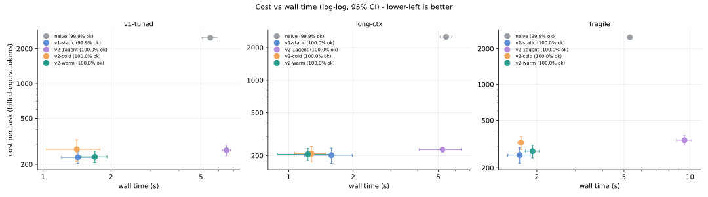

# Multi-Agent Swarm

**A team of AI agents for the jobs people actually do: research, building apps, writing,
data analysis, code review, translation, and thousands of small tasks. Every result is checked by
something other than the model's opinion.**

| | Command | Checked by |
|---|---|---|
| Research a question, with citations | `swarm research "question"` | quotes matched against the pages read; each cited claim checked against its quotes |
| Build an app (frontend, backend, CLI) | `swarm build "description" --out app --allow-execution` | its own tests, installed and run; failures go to a fixer |
| Write a long document | `swarm write "brief" --words 3000` | outline, section lengths, an edit pass that must keep every section |
| Analyze a CSV | `swarm analyze data.csv "question" --allow-code-execution` | every number must come from code that ran on your data |
| Review a codebase | `swarm review ./repo` | each finding must quote code that is really in the file |
| Translate, summarize or rewrite long documents | `swarm doc translate file.md --to German` | one glossary for every chunk; length checks |
| Thousands of small text, code or web tasks | `swarm run tasks.jsonl` | exact answers, regexes, tests, or grounded sources |

Work is split into parts that run in parallel. The parts share one plan so they fit together,
and agents never chat with each other. It runs on Claude or on any OpenAI-compatible model
(DeepSeek, Together, OpenRouter, vLLM ...), always with a hard dollar cap. Web search is
**free** through [TinyFish](https://tinyfish.ai). Guides: [deep research](docs/getting-started.md),
[build, write, analyze, review](docs/workflows.md), [batch tasks](docs/tasks.md).

## Deep research

Parallel workers each research one part of your question. They search the web and read the
sources themselves. Code then checks every quote a worker cites against the page it actually
read, and throws away quotes that don't match. Once the report is written, each cited
sentence is checked again against those quotes, and anything unsupported is marked.

[](https://github.com/Chetan0246/multi-agent-swarm/actions/workflows/ci.yml)


[](https://chetan0246.github.io/multi-agent-swarm/)

```bash
pip install "multi-agent-swarm[all]"
export ANTHROPIC_API_KEY=...    # Claude
export TINYFISH_API_KEY=...     # free search + fetch: https://agent.tinyfish.ai/api-keys
swarm research "How do heat pumps compare to gas boilers in cold climates?" --out report.html
```

Try it with no keys and no cost first: `swarm research "any question" --mock --out demo.html`.

## Features

| | |
|---|---|
| **Free web search** | TinyFish Search and Fetch as Claude tools: free within a daily allowance (12,000 searches and 1,000 pages per day). Claude's server-side search ($10 per 1,000 searches) is optional. |
| **Checked citations** | every quote is matched against the retrieved text; every cited claim is checked against its quotes; unsupported claims are marked in the report |
| **Predictable cost** | an estimate before the run, the actual cost after it, and a hard cap (`--max-usd`; presets default to $0.75, $2 or $6) |
| **Safe by default** | web text treated as data, not instructions; findings with injected instructions excluded; reports stripped of images, HTML and unknown links |
| **Your documents** | PDFs, Markdown, HTML and text files as sources (`--docs`), alone or alongside the web |
| **Follow-ups** | `--follow-up report.json` researches only what's new and rewrites the report |
| **Source filters** | domain allow/block lists, recency, news or research papers, language |
| **Exports** | Markdown, JSON, and self-contained HTML with hover-over source quotes |
| **Web UI and REST API** | `swarm serve`: live progress, history, downloads, follow-ups; research, write and doc jobs over HTTP |
| **Production-ready server** | a durable job queue with crash recovery, scalable `swarm worker` processes, per-user API keys with daily budgets and rate limits, Prometheus metrics, JSON logs; Docker Compose with HTTPS, Kubernetes and systemd setups ([docs/deployment.md](docs/deployment.md)) |
| **Local cache** | repeated searches and pages cost nothing and use no quota |
| **Batch tasks** | `swarm run tasks.jsonl`: thousands of small text, code or web-lookup tasks, each checked (exact answer, regex, tests run in a sandbox, or grounded sources), retried at higher effort and capped in dollars ([docs/tasks.md](docs/tasks.md)) |
| **Any model provider** | Claude, or any OpenAI-compatible API such as DeepSeek, Together, OpenRouter or vLLM (`--base-url`, `--model`, `--price`) |

## How it works

```
question ─► cost estimate (refuse if over the cap)
         ─► plan: independent sub-questions, count scaled to the question
         ─► one worker per sub-question, in parallel (a code scheduler, not an LLM manager)
              tools: web_search / web_fetch (TinyFish), search_documents / read_document (your files)
              answer = text + sources with VERBATIM quotes
              code: drop any quote not found in the retrieved text
              gate: ≥ 2 grounded sources from ≥ 2 domains, no injection markers
              weak finding → re-researched at higher effort (low → medium → high)
         ─► synthesis from clean findings only, inline [n] citations
         ─► reference check → claim check (each cited sentence vs. its quotes) → sanitise
```

The design follows the research summarised in
[docs/research](docs/research/Multi%20agent%20swarms%20state%20of%20the%20art.md):
- **Parallel workers on broad questions.** Breadth-first research is where multi-agent
  systems have the strongest evidence: Anthropic's research system scored +90.2% over a
  single agent.
- **No agent-to-agent chat.** Inter-agent misalignment is about a third of failures in the
  MAST study.
- **Verification in code.** Adding verification gave +15.6% in MAST, and self-reported
  confidence turns out to be a weak signal.

Details are in [docs/ARCHITECTURE.md](docs/ARCHITECTURE.md).

## Usage

```bash
swarm research "question" --estimate                          # what will it cost?
swarm research "question" --preset quick --out r.html          # quick | standard | deep
swarm research "question" --news --recency-days 30             # recent news only
swarm research "question" --papers --include-domains arxiv.org,nature.com
swarm research "question" --docs ./papers ./notes.md           # your files + the web
swarm research "question" --docs ./contracts --docs-only       # your files only
swarm research "and costs?" --follow-up r.json --out r2.html   # build on an earlier report
swarm research "question" --base-url https://host/v1 --model MODEL --price 0.10,0.40
                                                               # any OpenAI-compatible provider
swarm run examples/tasks/mixed.jsonl --allow-code-execution    # batch: text, code (tested), web (cited)
swarm serve                                                    # web UI on http://127.0.0.1:8000
swarm doctor --online                                          # check keys and setup
swarm eval --estimate                                          # known-answer evaluation vs a single agent
```

The full flag reference is in [docs/cli.md](docs/cli.md); config files and environment
variables are in [docs/configuration.md](docs/configuration.md); the web UI and REST API are
in [docs/web-api.md](docs/web-api.md).

## Deploy

```bash
cp deploy/.env.example deploy/.env    # your domain and keys
docker compose -f deploy/compose.yaml up -d --build
docker compose -f deploy/compose.yaml exec api swarm keys create --name alice --daily-usd 5
```

That gives you HTTPS through Caddy, an API process, workers you can scale, and jobs that
survive restarts. Kubernetes and systemd setups are in `deploy/`; the full guide is
[docs/deployment.md](docs/deployment.md).

## Costs and privacy

- **TinyFish search and fetch:** free within the daily allowance.
- **Claude:** charged per token. For example, `claude-opus-5-5` costs $4 per million input
  tokens and $20 per million output tokens; `--worker-model claude-sonnet-5-5` makes the
  workers cheaper.
- **Data flow:** your question and retrieved text go to Anthropic, and search queries go to
  TinyFish. Caches stay on your machine. There is no telemetry. See
  [docs/privacy.md](docs/privacy.md).

## Engine

Under the research layer sits a general **cost-aware, fault-tolerant scheduler** for large LLM
workloads (`swarm run`, `swarm bench`). It has:
- a pull-based queue sized to the fewest agents that still finish fast;
- multi-task batching, with batch size and effort learned online by Thompson sampling;
- effort escalation for failed tasks only;
- an AIMD rate limiter that understands Anthropic's 429 types;
- a circuit breaker, request hedging, a token budget and a write-ahead journal;
- a Batches API backend at half price.

On a simulated hostile endpoint it is **7.5–11× cheaper per task and 2.7–4.6× faster than a
naive swarm, with 4–4.6× fewer agents**. These are the ranges over 18 runs (3 endpoint
profiles × 6 seeds, 500 tasks each). Against the hand-tuned v1 rules it is roughly even
(0.87–1.17× the cost, 0.83–1.42× the speed); its gain there is reliability. Wall time is
measured in real time, so small runs (`--n 120`) vary much more.



## Development

```bash
pip install -e '.[dev]'
make lint test        # ruff, mypy, 118 tests (all offline: no keys, no cost)
make bench chart      # engine benchmark + charts
```

See [CONTRIBUTING.md](CONTRIBUTING.md). Report vulnerabilities privately: see [SECURITY.md](SECURITY.md).

```
swarm/
  research.py   deep research: planner, tool-using workers, quote grounding, synthesis, claim check
  search/       TinyFish (free), local documents (BM25), disk cache, mock
  app.py        options → configured run (shared by CLI and server)
  server.py     REST API + web UI (web/index.html), job store, SSE progress
  export.py     Markdown / JSON / safe self-contained HTML
  safety.py     prompt-injection detection, report sanitising
  pricing.py    list prices, run cost, estimates
  evaluate.py   known-answer evaluation vs a compute-matched single agent
  orchestrator.py, policy.py, reliability.py, limiter.py, backends.py   the scheduling engine
```

## Roadmap

- [ ] Publish `swarm eval` results on live search, then scale to a BrowseComp-style set.
- [ ] Semantic (meaning-based) matching of quotes and claims, alongside exact matching.
- [ ] Per-message effort escalation, so the prompt cache survives across effort levels.
- [ ] More search providers, and OpenTelemetry traces.

MIT licensed. Not affiliated with Anthropic or TinyFish.
