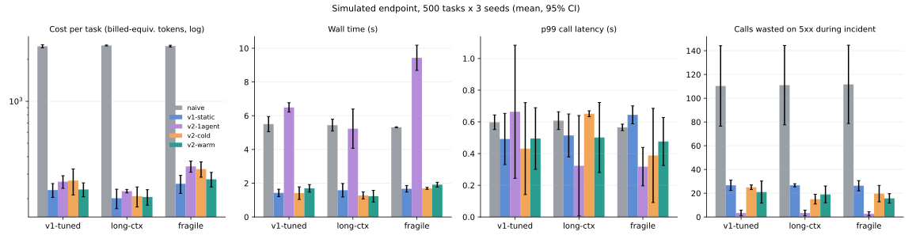

# Multi-Agent Swarm

**A cost-aware, fault-tolerant scheduler that runs large LLM workloads with the fewest agents,
the fewest tokens per task and the highest verified success rate, built from what the
2025–2026 multi-agent research actually supports.**


> **Thesis**, from the [research report](docs/research/Multi%20agent%20swarms%20state%20of%20the%20art.md):
> *schedulers, not swarms, make multi-agent pay.* The best controlled study (260
> configurations) finds the **mean** multi-agent gain over a single agent is about **−0.3%**.
> Multi-agent wins only on decomposable work (up to +81%) and loses badly on sequential tasks
> (down to −70%). Most failures are design and verification failures, not model failures. So
> this project treats agents as **independent, verifiable workers behind an adaptive
> scheduler**, and spends its engineering on control: how much compute each item deserves,
> and how to prove the answer before paying for more.

## Results at a glance

Offline simulator, 500 tasks × 3 seeds, against a hostile endpoint: 4% of calls are 10×
stragglers, and a 0.4 s 5xx incident fails 90% of calls. It runs on three endpoint profiles
that differ in how much accuracy big batches cost. Means are shown with 95% CIs.

| (profile `v1-tuned`) | naive | v1-static | v2 single agent | **v2 (warm)** |
|---|---|---|---|---|
| Verified success | 99.9% | 99.9% | 100% | **100%** |
| Cost per task (billed-equiv. tokens) | 2482 | 231 ± 26 | 265 ± 28 | **233 ± 27** |
| Wall time | 5.50 s | 1.43 s | 6.49 s | **1.70 s** |
| Agents | 32 | 7 | 1 | **7–8** |
| Calls wasted during the 5xx incident | 110 | 27 | 3 | **21** |




**What the numbers say, honestly:**
- **Against a naive swarm** (one task per call, 32 agents, high effort), it is **9–12×
  cheaper per task, 2.8–4.4× faster, and uses about 4× fewer agents**, at equal or higher success.
- **Against the same pipeline with one agent** (compute-matched baseline), token cost is about
  the same, but wall time is **3–5× shorter**. The extra agents buy throughput, not accuracy,
  which is exactly what the literature predicts for independent items.
- **Against v1** (hand-tuned static rules), cost per task is **within the confidence interval**
  on all three profiles. The learned policy doesn't beat good hand tuning in a simulator
  those rules were tuned on. Its value is not needing that tuning on a real endpoint, at the
  price of an exploration premium on a cold first run, which is why the learned state
  persists. Wall time: v2 was 14–19% slower than v1 on two profiles (circuit-breaker
  cool-downs during the incident) and 22% faster on the third.
- **Not measured here:** the two biggest real-world savings, the **Batches API (−50%)** and
  **prompt-cache reads (0.05–0.1× input price)**, because the simulator doesn't model them.
  Nothing here measures Claude's accuracy; run `swarm run` on your own tasks for that.

## How it works

```
tasks ─► resume (WAL) ─► dedupe/cache ─► pools[(min_rung, difficulty)]
                                               │  lazy batching at dispatch time
                                               ▼
                          scheduler ── policy picks (effort rung, batch size)
                                               │
          ┌──────────── agent pool (knee-sized, AIMD-limited) ────────────┐
          │  budget reserve → breaker route → call (+hedge if straggling) │
          └───────────────────────────────┬───────────────────────────────┘
                                          ▼
                 verify: deterministic checker, or agreement of 2 answers
                   ok → journal      fail → next rung (or retry at top)
```

| Component | Idea | Grounded in |
|---|---|---|
| **Pull-based queue** | Workers pull the next batch the moment they're free; batches are formed lazily | Fixes the synchronous-subagent bottleneck Anthropic names in its research system |
| **Knee-sized pool** | Smallest agent count within 15% of the best makespan | Coordination overhead of 58–515% (Kim et al. 2025) |
| **Batch prompting** | Many tasks per call, compact JSON, structured output | Batch Prompting (Cheng et al.), BatchPrompt |
| **Bandit scheduler** ★ | Bayesian-logistic Thompson sampling over (batch size × effort), plus a DP over the escalation ladder minimising cost per verified task | Cascades (FrugalGPT, AutoMix); RoBatch is offline. **No prior online bandit over batch size was found** |
| **Effort escalation** | Only failures move up (low → medium → high), then retry at the top | Model upgrade beat 2× tokens (Anthropic); debate ≈ voting (Choi et al., NeurIPS '25) |
| **Verification** | Code checks, or agreement of 2 independent answers when no checker exists | MAST: verification step +15.6%; verbal confidence AUROC ≈ 0.52–0.61 |
| **Provider-aware 429s** | Spend cap → stop cleanly; ramp limit → hold the rate; `retry-after` honoured | Anthropic rate-limit docs |
| **Circuit breaker / hedging / AIMD** | Reroute or wait on 5xx; duplicate p95 stragglers (≤ 8%); multiplicative backoff | Google SRE; *The Tail at Scale* |
| **Budget + write-ahead journal** | Hard token ceiling; crash-safe resume | Cost-aware evaluation (HAL); durable execution (Temporal/DBOS/Restate) |
| **Batches API + caching** | 50% price backend; shared context behind a cache breakpoint | Anthropic pricing docs |

★ = the project's novel contribution. Full rationale, with citations, in
[docs/ARCHITECTURE.md](docs/ARCHITECTURE.md).

## Research

[**Schedulers, not swarms, make multi-agent pay**](docs/research/Multi%20agent%20swarms%20state%20of%20the%20art.md)
is a cited, ~5,000-word review of the state of the art as of November 2026, with its source
notes in [`docs/research/notes/`](docs/research/notes/). It covers:
- orchestration patterns and the 2026 framework landscape (LangGraph, Microsoft Agent
  Framework, OpenAI Agents SDK, CrewAI, ADK, A2A/MCP; AutoGen archived, MetaGPT dormant);
- when multi-agent beats single-agent, the debate-vs-voting evidence, and scaling with agent count;
- the MAST failure taxonomy (1,642 traces, 41–87% failure rates);
- stacked provider discounts, routing and cascades, and batch prompting;
- distributed-systems reliability for LLM APIs;
- benchmark saturation and cost-aware (Pareto) evaluation;
- a section mapping each finding to this design, including its gaps.

## Quick start

```bash
pip install -e '.[dev]'
```

```bash
make lint test
```

```bash
make bench chart
```

### On Claude

```bash
python -m swarm gen tasks.jsonl --n 50
```

```bash
python -m swarm run tasks.jsonl --out results.jsonl --events
```

```bash
python -m swarm run tasks.jsonl --batch-api --budget 2000000
```

The second command uses the real-time API. The third uses the Batches API at half price,
with a spending cap. Credentials come from `ANTHROPIC_API_KEY` or an `ant auth login`
profile. The default ladder is `claude-opus-5-5` at `low → medium → high` effort.

Input is JSONL, one task per line:

```json
{"id": "q1", "prompt": "What is 17+25? Number only.", "difficulty": 1, "expected": "42", "priority": 0}
```

`expected` (exact match), `pattern` (regex) or a Python `validator` makes a task verifiable.
Without one, an answer is accepted when two independent attempts agree.

| Flag | Default | Meaning |
|---|---|---|
| `--efforts` | `low,medium,high` | escalation ladder on `--model` |
| `--max-batch` / `--max-agents` / `--agents` | 24 / 8 / auto | batching and pool limits |
| `--batch-api` | off | Message Batches API: 50% price, up to 24 h latency |
| `--budget` | none | ceiling in billed-equivalent tokens |
| `--shared-context FILE` | none | context common to all tasks, cached |
| `--state-dir` | `.swarm` | `journal.jsonl` (resume), `policy.json` (learned), `events.jsonl` |
| `--static`, `--no-hedge`, `--no-fallbacks`, `--mock` | | turn features off, or run offline |

## Evaluation methodology

Following *AI Agents That Matter* (Kapoor et al. 2024) and HAL (ICLR 2026):
- several seeds, with means and 95% CIs;
- cost and time reported together, on a Pareto view;
- baselines: a naive swarm, a **compute-matched single agent**, and the previous version
  (best fixed configuration);
- an adversarial simulator with three endpoint profiles, **clearly labelled as simulated**.

CI runs ruff, mypy, 27 tests on Python 3.10–3.13, and a benchmark smoke test. The tests cover
the policy maths, every reliability path, and both real backends against a mocked HTTP
transport, with no network and no spend.

## Project layout

```
swarm/
  orchestrator.py  engine: resume → dedupe → schedule → call → verify → escalate
  policy.py        Bayesian-logistic Thompson sampling, cost model, ladder DP
  reliability.py   circuit breaker, hedger, token budget, write-ahead journal
  backends.py      real-time API, Batches API, simulator; 429 classification
  limiter.py       AIMD concurrency (with ramp-limit hold)
  planner.py       config, escalation ladder, agent-count knee
  task.py          tasks, checkers
  __main__.py      CLI: bench / run / gen
docs/
  ARCHITECTURE.md  design decisions with evidence
  research/        literature review + source notes
  assets/          benchmark JSON and charts
scripts/plot_benchmark.py
tests/test_swarm.py
```

## Limitations and roadmap

- [ ] Real-endpoint benchmark on Claude: dollars per verified success, the effort sweep, and
      whether batching reduces thinking tokens on adaptive-thinking models (open questions in
      the report).
- [ ] Per-message effort escalation, so the prompt cache survives across rungs.
- [ ] Discount old evidence in the bandit (non-stationary endpoints); contextual features.
- [ ] Semantic (not exact-match) agreement for free-form answers.
- [ ] OpenTelemetry GenAI spans (a JSONL event log exists today).
- [ ] Idempotent replay of in-flight calls after a crash (results are already deduplicated).

See [CHANGELOG.md](CHANGELOG.md) for the v1 → v2.1 history. MIT licensed.
